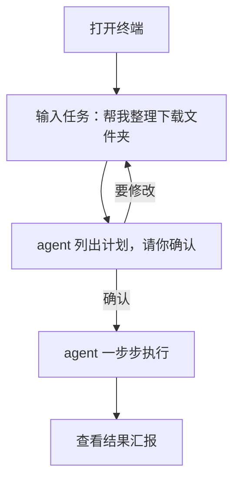
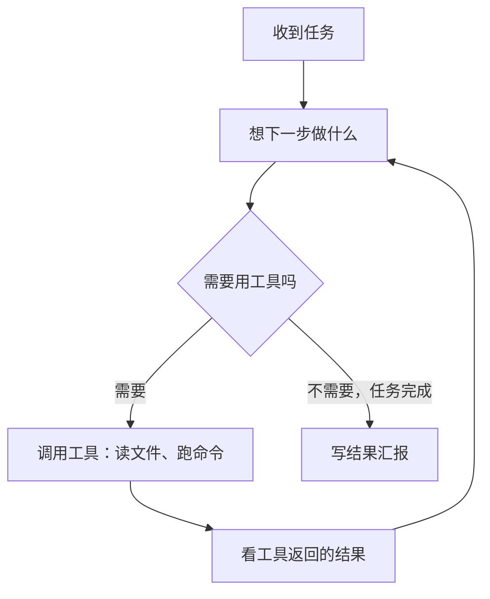

# 流程图：example/agent-demo

> 示例内容：这个项目是虚构的，只用来检查网页的显示效果。

## 用户的操作流程

用户只做三件事：说任务、确认计划、看结果。中间的执行全交给 agent。

## agent 内部的流程

关键是"想下一步 → 用工具 → 看结果"这个循环：没做完就回到"想下一步"，一直转到任务完成。这就是 agent 和工作流最大的区别。

两张图对照着看：用户看到的"agent 一步步执行"，在内部就是这个循环转了好几圈。
