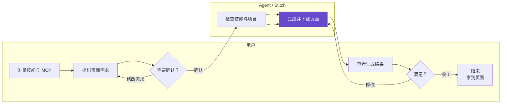
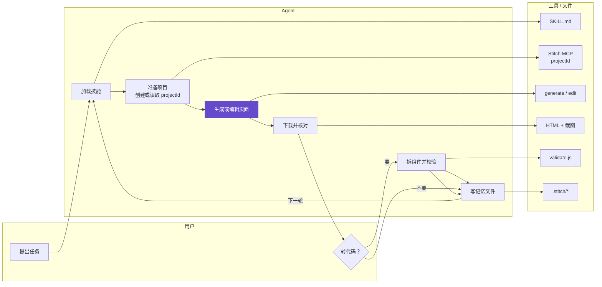

# 流程图：google-labs-code/stitch-skills

## 用户的操作流程

## agent（或系统）内部的流程

## 两张图怎么对上

**你眼里的「一步」，其实是内部一长串。**

第一张图里，Agent 的「检查技能与项目 → 生成并下载页面」，在第二张图里展开成「加载技能 → 准备项目 → 生成或编辑 → 下载并核对」。绿色点线继续指向每一步使用的工具或产物：`SKILL.md`、`projectId`、HTML、截图。中间任何一环断了（没配 MCP、项目 ID 丢了、下载链接过期），你看到的现象就只是「它卡住了」，所以第 3 步会把每一环单独试一遍。

**你被问到的那几次，都是内部的风险点。**

第一张图的「需要确认？」不是多余停顿：本地已经有 `.stitch/designs/{page}.html` 时，技能明确规定必须问你要不要覆盖，不许默认覆盖；要跑 `npm run validate`、起本地服务、开浏览器截图之前，也必须问过你。这些在技能里写在 `GATE`（门槛）那一段，属于「不过这道门不许往下走」。

**「循环」是两根接力棒，不是一个大 while。**

第二张图底部橙色虚线 `写记忆文件 → 加载技能` 表示下一轮。这一轮结束时，agent 必须把「下一轮做什么」写进 `.stitch/next-prompt.md`，下一轮的 agent（甚至可以是另一个模型、由 CI 触发）读这个文件就能接着干。所以循环不依赖上下文——**换 agent 也不断线**。这也是这个仓库最值得偷的一点：把状态放在文件里，不放在对话里。

**「修改」和「下一页」看起来都往回走，内部成本却不同。**

第一张图里，「修改」回到生成并下载页面，内部走的是 **edit** 流程（`edit_screens`），改的是 Stitch 上那张已存在的屏幕；「下一页」也会回到提出需求，但和「修改需求」是同一条路径，图上不再多画一条线，免得两条回边挤在一起看不清。两者在内部的成本也不同：只有「下一页」才回到 `generate_screen_from_text`。技能里对这两条路的要求刚好相反：生成时禁止在 prompt 里写颜色和字体（设计系统在项目层统一管），编辑时允许写十六进制色值，因为你就是要精确改那一个按钮。
