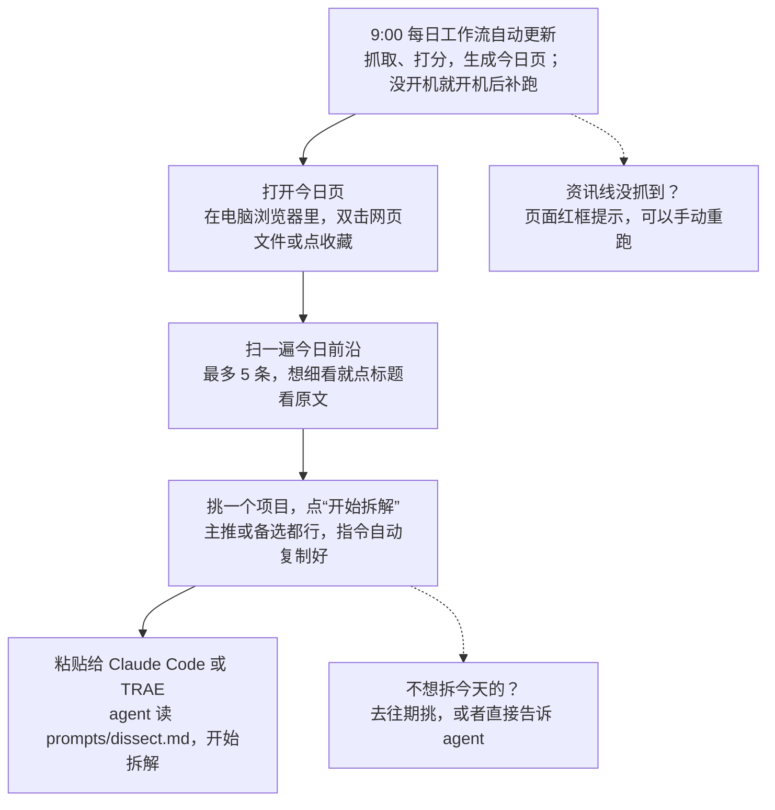
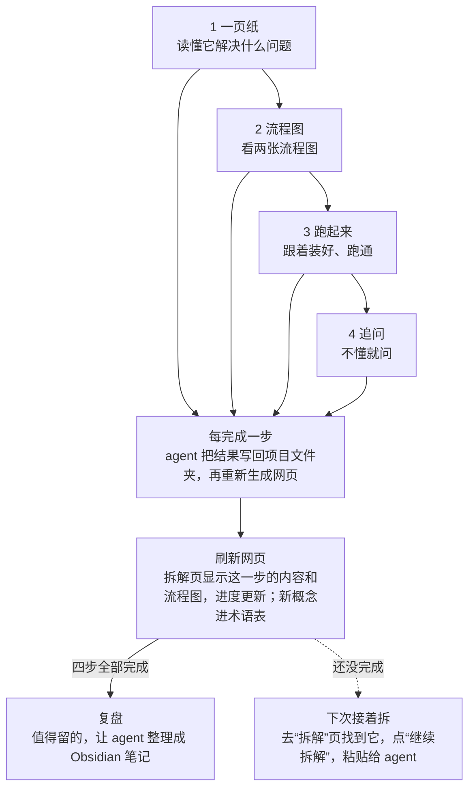

# 今日一拆 · 产品需求文档（PRD）

> 版本：v1.2 · 更新：2026-11-16 · 状态：已定稿（要改需求，先改这份文件，并在决策记录里写明原因）
>
> 一句话：每天上午自动挑出值得拆的 AI 项目和值得知道的 AI 资讯，再带你用四步法，把一个项目从"它解决谁的什么问题"一路拆到"亲手跑起来"。

## 1. 为什么做

- **目标**：用半年到一年时间，转到 FDE（Forward Deployed Engineer）类岗位。FDE 要能听懂客户的业务需求，判断该用什么 AI 方案，并且很快搭出能演示的原型。
- **现状**：现成的资讯工具（资讯雷达、RSS 阅读器、自动简报）各有长处，但数量多、内容杂，拼起来很难，做出来也容易不看。这个想法拖了很久，一直卡在"没想清楚"。
- **所以这个产品要做到三点**：
  1. 只有一个入口：一个网页。
  2. 每天的内容有上限：3 个项目、最多 5 条资讯。
  3. 核心是拆解项目，而不是刷资讯。

## 2. 用户

只有你一个人：

- 编程基础很少，主要靠 AI 写代码。
- 目前每天能投入 5 小时以上。
- 手上的工具：Claude Code、TRAE、DeepSeek API。
- 有自己的 Obsidian 知识库，习惯学完、用完再手动整理进去。
- 在意 token 成本，不想只绑定一个 agent。

## 3. 每天怎么用

| 时间 | 做什么 | 在哪 |
|---|---|---|
| 9 点 | 工作流自动跑完，生成今日页 | 自动 |
| 约 30 分钟 | 看今日页：从 3 个项目里挑一个，扫一遍资讯 | 网页 |
| 2～3 小时 | 点"开始拆解"复制指令，粘贴给 agent，按四步拆 | agent |
| 约 1 小时 | 追问，动手改一个小功能 | agent |
| 约 30 分钟 | 复盘，把值得留的内容整理进 Obsidian | agent → Obsidian |

### 用户操作流程

**早上：从自动更新到开始拆解**（虚线是分支情况）

**拆解时和拆完后**

## 4. 系统由哪三部分组成

| 部分 | 是什么 | 说明 |
|---|---|---|
| 每日工作流 | 工作流：步骤固定，每天照做 | 分成项目线和资讯线，每天 9 点同时运行，结果合到今日页 |
| 网页 | 唯一的阅读入口 | 一共 4 页，第一版只在本地电脑上看 |
| agent | Claude Code 或 TRAE | 按项目里的规则文件拆解项目，把结果写回项目文件夹。我们不从零开发 agent，只给现成的 agent 写工作说明 |

三部分通过同一个项目文件夹连起来：工作流把今日内容写进文件夹，网页从文件夹读取内容来显示，agent 把拆解结果写回文件夹。

## 5. 功能与验收标准

### F1 项目线：今天拆哪个

**做什么**

- **来源**：GitHub Trending（每天）和 HelloGitHub（每月一期）。HelloGitHub 出新一期时，把里面的项目放进"项目池"；Trending 每天也往项目池里加新项目。
- **排除**：推荐过的项目（以前某天的主推）和已经开始拆的项目，不再推荐。
- **打分**：看两点。一是值不值得拆：和 AI、agent 有多相关，对练产品思维有多大价值。二是零基础好不好上手：有没有清楚的安装说明，需不需要显卡这类特殊硬件。
- **产出**：1 个主推 + 2 个备选。每个项目都写三项：一句话介绍、能解决谁的什么问题、对你有什么价值。主推再多写一项"为什么拆它"。

**验收**

- [ ] 运行一次后，今日页出现 1 个主推和 2 个备选，每个都带上面这些说明。
- [ ] 连续运行两天，第二天不会再推第一天的主推。
- [ ] 已经开始拆的项目不会再被推荐。
- [ ] 项目线抓取失败时，资讯线照常产出，页面上提示"项目线今天没抓到"。

### F2 资讯线：今天该知道什么

**做什么**

- **分工**：项目线负责「今天拆哪个」；资讯线负责「今天该知道什么**判断与趋势**」——实时跟上走在前列的人的想法和思路。资讯不是再推荐几个能拆的仓库。
- **来源**：12 个资讯源，只看最近 **24 小时**（实时）：量子位、InfoQ 中文、OpenAI、Google AI、Hugging Face、Simon Willison、Latent Space、smol.ai、Hacker News、GitHub 博客、爱范儿、极客公园。
- **合并**：几家报道的是同一件事，只留一条；同题优先当事人论述完整的那篇。
- **挑什么**：优先有观点、有结论的前沿信息——前列人物怎么想、AI 往哪走、怎么用（路线、应用层、组织/落地）；现在新能做什么、边界在哪。未核实传闻、纯仓库安利清单降权。
- **分栏**：每条分进 4 个栏目之一（按「建立哪种判断」分，不按「是不是开源项目」分）：
  - 新能力：现在新能做什么，以及边界在哪
  - 新工具：改变「怎么用 AI」的方法、协议或基础设施（重点是用法与能力，不是安利待拆仓库）
  - 新产品：能看出路线或用法变化的重要产品更新
  - 落地案例：组织/行业怎么用 AI、得出什么可迁移的结论
- **产出**：最多 5 条。每条写四项：发生了什么（含结论或边界）、能澄清谁的什么困惑、对你意味着什么、来源（附原文链接和发布时间）。

**验收**

- [ ] 今日页的资讯最多 5 条，每条都有栏目标签和上面四项。
- [ ] 同一件事不会出现两次。
- [ ] 只放摘要和原文链接，不全文转载。
- [ ] 资讯线失败时，项目线照常产出，页面上提示"资讯线今天没抓到"。

### F3 网页：4 个页面

1. **今日**
   - 上半部分是今日一拆：主推和 2 个备选，每个项目都有一个"开始拆解"按钮。主推如果已经开始拆，显示四步进度。
   - 下半部分是今日前沿：最多 5 条资讯。
2. **往期**：按日期列出以前的今日页，点进去看到的内容和当天一样。
3. **拆解**：拆过的项目列表，每个项目显示四步进度。点进去是这个项目的四步内容，流程图直接显示成图。没拆完的项目，详情页上有一个"继续拆解"按钮。
4. **术语表**：学过的概念，拆解时 agent 会往里加。

**验收**

- [ ] 在电脑浏览器里打开今日页，2 秒内完整显示。
- [ ] 不用开任何服务：双击生成的网页文件，或者运行一个命令，就能在电脑浏览器里打开。
- [ ] 拆解页里的流程图显示成图，而不是一段代码。
- [ ] 点"开始拆解"，指令会被复制到剪贴板。
- [ ] 拆解详情页上，没拆完的项目有"继续拆解"按钮，点了能复制指令；四步都完成后不再显示这个按钮。
- [ ] 页面用到的所有文件都在本地，不依赖国外网站，打开不卡。
- [ ] 亮色和暗色模式下都看得清。

### F4 接 agent：复制指令

**做什么**

- 点"开始拆解"会复制一句指令，例如："请按照 prompts/dissect.md 拆解 https://github.com/作者/项目名"。
- 拆解详情页的"继续拆解"按钮复制的是同一句指令。agent 发现这个项目已经开始拆了，就从没完成的那一步接着做。
- 也可以不通过网页，直接对 agent 说要拆哪个项目。
- 拆解方法写在 `prompts/dissect.md` 里，Claude Code 和 TRAE 读的是同一份（两者的规则文件都会指向它）。agent 从里面知道：拆解结果写到哪、按什么步骤拆、怎么讲解。
- 拆解分四步：
  1. **一页纸**：解决谁的什么问题，为什么是现在，用户以前怎么解决，它好在哪。
  2. **两张流程图**：一张画用户的操作流程，一张画 agent（或系统）内部的流程。
  3. **跑起来**：在本地装好、跑通，每条命令都解释清楚。
  4. **追问**：你在 agent 里问，问答记录写回项目文件夹。
- 拆解中遇到的新概念，都写进术语表。

**验收**

- [ ] 把复制的指令粘贴到 Claude Code，它能自己按四步开始拆，不用你再解释规则。
- [ ] 换成 TRAE，同一句指令也能做到。
- [ ] 每完成一步，刷新网页就能看到进度更新。
- [ ] 讲解是零基础能听懂的话，新概念出现在术语表里。

### F5 定时运行和手动更新

**做什么**

- 每天 9 点自动运行。9 点没开机的话，开机后补跑。
- 留一个手动更新的办法，比如双击一个文件。可以两条线一起跑，也可以只重跑其中一条。

**验收**

- [x] 9 点电脑开着时，9 点 10 分之前今日页已经更新。
- [x] 9 点没开机时，开机后几分钟内补跑完成。
- [x] 手动更新可以单独重跑项目线或资讯线。

## 6. 非功能要求

- **快**：网页打开快，所有资源都放在本地。
- **省**：每日工作流只用 DeepSeek，每天调用次数固定，花费可以预期。
- **稳**：任何一个信源失败，都不影响其他信源和另一条线；失败原因显示在页面底部。
- **安全**：API Key 只放在本地的 `.env` 文件里，不写进代码和文档。
- **可接手**：任何 agent 读完项目里的文档（PRD、TECH、PROGRESS、BACKLOG、AGENTS.md），就能接着做。

## 7. 第一版不做的事

- 不自动同步 Obsidian，由你学完后手动整理。
- 不公开网站，只在本地看；第 2 周起再搬到阿里云服务器。
- 不做手机上看：第一版只在电脑上用。网站用顺了，再升级成手机也能看（页面已经按手机宽度排好版，到时不用重做）。
- 不做网页上一键启动 agent。
- 不做网页里的聊天框（以后可以加，用 DeepSeek 来回答追问）。
- 不从零开发 agent（第 3 周以后可选：自己写一个小 agent 当练习）。
- 不加其他页面：进度、收藏、搜索都先不做。
- 不把资讯里提到的开源项目放进项目池（先记进 BACKLOG）。

## 8. 开发顺序

每一步做完都由你验收，通过了再做下一步：

1. 写 PRD（就是本文件）（已完成）
2. 写好开发文档：README、TECH（含项目结构设计）、AGENTS、PROGRESS、BACKLOG，保证换哪个 agent 都能接着做。代码、配置和数据的文件夹不在这一步建，开发到哪一步再建哪部分（已完成）
3. 用示例数据做出 4 个页面，你在浏览器里看效果、提修改
4. 接真实数据：让项目线和资讯线跑起来
5. 接 agent：复制指令、进度显示，并在 Claude Code 和 TRAE 里实测
6. 定时运行和手动更新
7. 第 2 周起：搬到阿里云服务器（用 IP 访问，加访问密码）

## 9. 决策记录

| 日期 | 决定 | 原因 |
|---|---|---|
| 2026-11-13 | 系统 = 工作流 + 现成的 agent，不从零开发 agent | 每日抓取的步骤是固定的，适合用工作流；拆解需要随机应变，交给成熟的 agent |
| 2026-11-13 | 网页第一版只在本地看，第 2 周起再上阿里云 | GitHub Pages 在国内访问卡 |
| 2026-11-13 | agent 先用"复制指令"来接 | 哪个 agent 都能用，你也能看着它干活；"一键启动"只支持 Claude Code，而且看不到过程 |
| 2026-11-13 | "开始拆解"之后的步骤不放按钮 | 后面的步骤直接在 agent 里说就行 |
| 2026-11-13 | 项目和资讯分成两条线 | 两者的来源、频率、去重方式、打分标准、产出都不一样，而且一条出错不会影响另一条 |
| 2026-11-13 | 网页只做 4 页 | 先做简单，避免"做出来不看" |
| 2026-11-13 | 今日页在上午 9～10 点前准备好 | 这是你开始学习的时间 |
| 2026-11-13 | 资讯源用这 11 个 | 实测都能访问；机器之心、36 氪、LangChain 的源抓不到 |
| 2026-11-13 | 写代码之前先写好开发文档 | 规则和进度都写在文件里，换哪个 agent 都能接着做 |
| 2026-11-13 | 开发文档和项目架构分开：第 2 步只写开发文档，项目结构写进 TECH.md 当设计图，开发时再按需建 | 避免把文档和代码目录混在一起；拆解四步法属于产品功能，放在 prompts/dissect.md，不写进 AGENTS.md |
| 2026-11-16 | 拆解详情页加"继续拆解"按钮 | 画用户操作流程图时发现：已经开始拆的项目，第二天不会再出现在推荐里，隔天接着拆缺一个入口 |
| 2026-11-16 | PRD 加入用户操作流程图（第 3 节） | 让需求和真实用法对得上；下一个 agent 也能看到用户每天到底怎么用 |
| 2026-11-16 | 第一版只在电脑上看：网页文件直接双击打开，不开本地服务；手机以后再升级（v1.2） | 你的决定：电脑上能用就行，网站好用了再做手机。这样不用一直开着一个服务，也不会弹防火墙提示 |
| 2026-11-18 | 资讯线定位为「判断与趋势 / 前列人物思路」，不是仓库安利；与项目线明确分工 | 你要每天扫一眼跟上走在前列的人怎么想；「今天拆哪个」只由项目线负责 |
| 2026-11-18 | 资讯源增加极客公园 | 原 11 源覆盖不到李彦宏等中国产业领袖论述；极客公园 RSS 实测能抓到「百度世界 / 智能组织」等稿 |
| 2026-11-18 | 资讯时间窗保持 24 小时实时 | 试过拉长窗口后任务负担偏重；用户决定仍按当天实时拉取 |

## 10. 待定问题

- 阿里云服务器的地域和学生包到期时间：会影响第 2 周怎么部署。
- TRAE 规则文件的具体格式：接 agent 时再确认。
